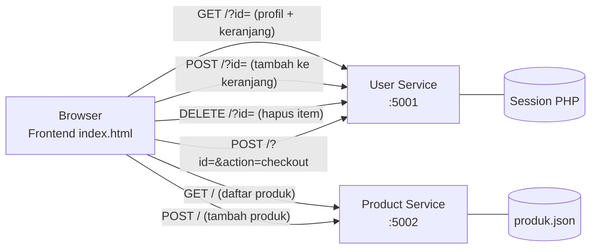
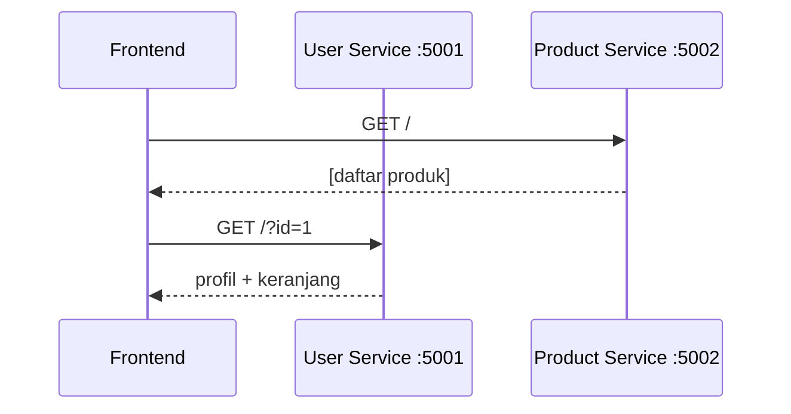
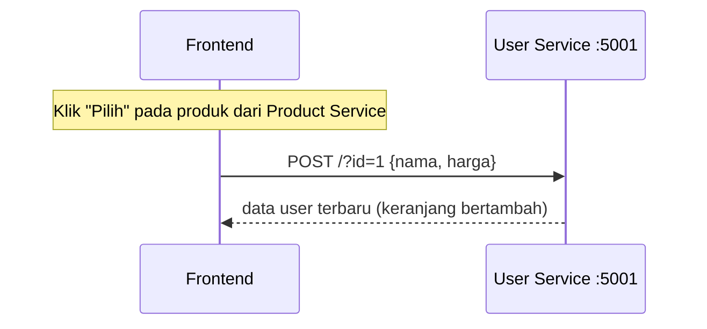
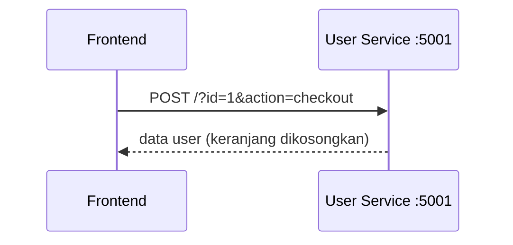
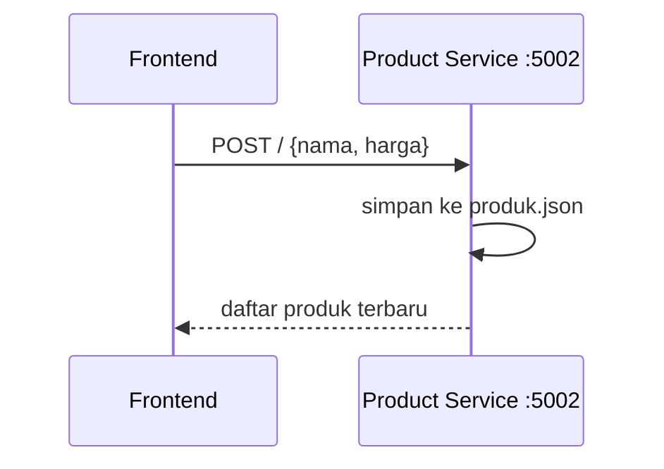

# Arsitektur Aplikasi E-Commerce Mikroservis (PHP Native)

> Ditulis dari kode versi awal `main` (frontend, user-service, product-service).
> Order Service (:5003) dan integrasi user-service → product-service (versi Zaka/Dimas) belum dimasukkan. Lihat bagian "Rencana update".

## Komponen

| Komponen | Port | Teknologi | Tugas | Penyimpanan data |
|---|---|---|---|---|
| Frontend | (dibuka langsung `index.html`) | HTML + JavaScript (fetch) | Dashboard: profil, keranjang, daftar produk | - |
| User Service | 5001 | PHP native | Profil pengguna, keranjang, checkout | `$_SESSION` (memori server, sementara) |
| Product Service | 5002 | PHP native | Daftar produk, tambah produk | File `produk.json` |

Semua service mengembalikan JSON dan mengaktifkan CORS (`Access-Control-Allow-Origin: *`) supaya bisa dipanggil dari browser.

## Diagram alur

## Alur utama

### 1. Membuka dashboard

### 2. Memilih produk ke keranjang

Catatan: pada versi awal, frontend mengirim `nama` dan `harga` produk ke User Service. User Service tidak memanggil Product Service.

### 3. Checkout

### 4. Menambah produk ke toko

## Rencana update (isi setelah merge)
- Order Service (:5003): checkout dan riwayat pesanan.
- User Service memanggil Product Service lewat HTTP memakai `produk_id`.
- Perbarui diagram di atas setelah branch Zaka/Dimas di-merge.
