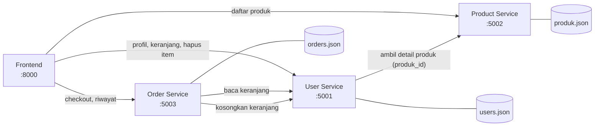
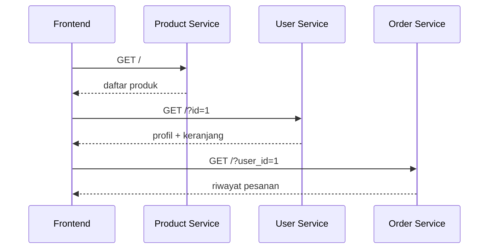
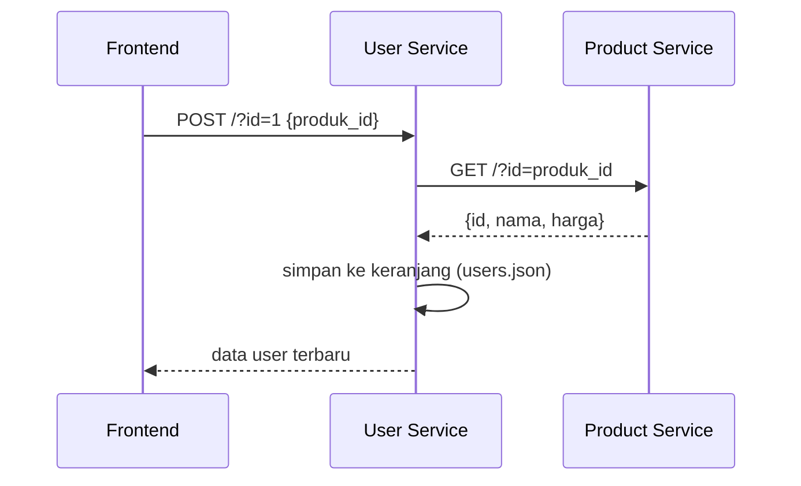
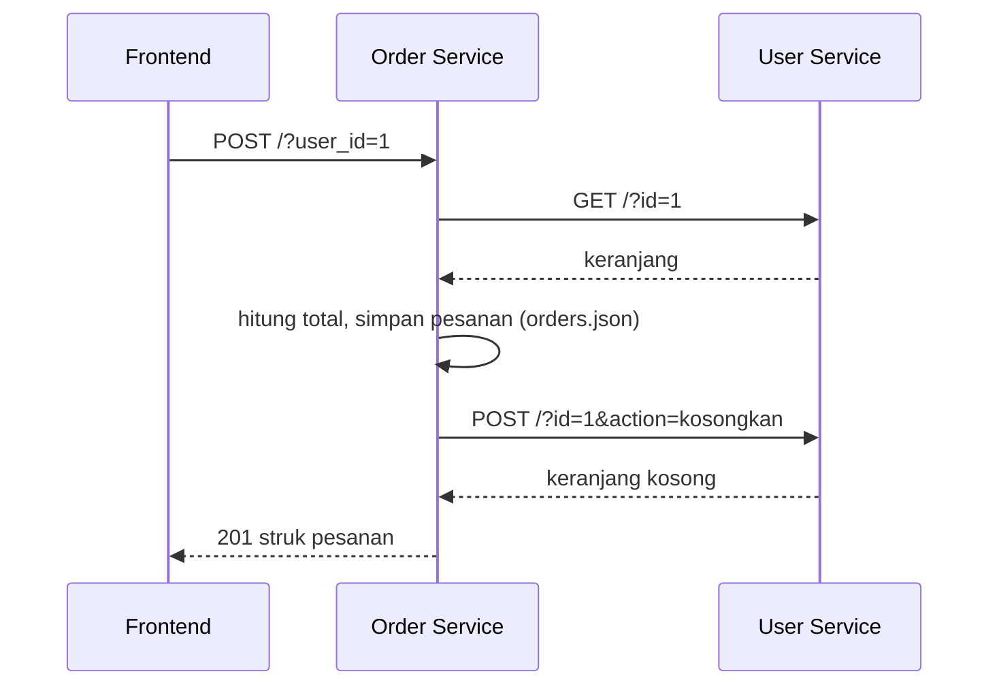
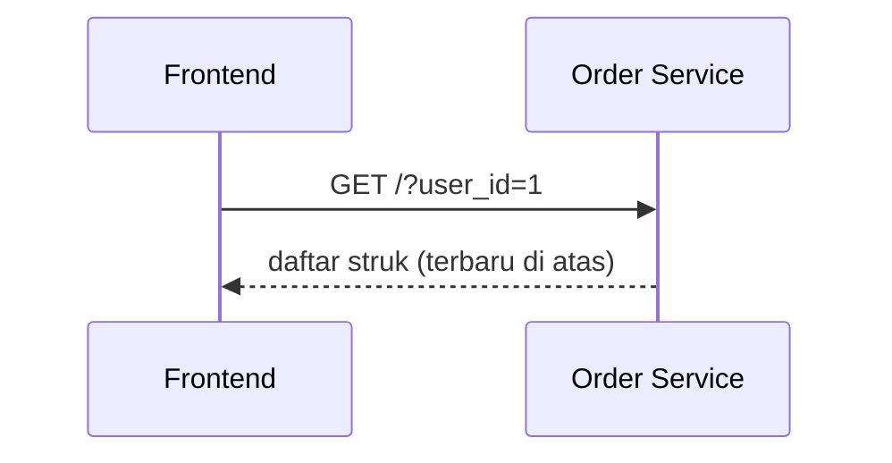

# Arsitektur Aplikasi E-Commerce Mikroservis (PHP Native)

> Berdasarkan kode terbaru di branch `main`.

## Komponen

| Komponen | Port | Tugas | Data |
|---|---|---|---|
| Frontend (`index.html`, `script.js`, `style.css`) | 8000 | Tampilan dan pemanggil API | - |
| User Service | 5001 | Profil pengguna dan keranjang | `users.json` |
| Product Service | 5002 | Daftar produk | `produk.json` |
| Order Service | 5003 | Checkout dan riwayat pesanan | `orders.json` |

Prinsip: tiap service punya data sendiri dan berkomunikasi lewat HTTP (JSON). Semua mengaktifkan CORS.

## Diagram alur



Panah dari frontend adalah panggilan dari browser. Panah antar service (User → Product, Order → User) adalah panggilan service ke service lewat HTTP.

## Alur utama

### 1. Membuka halaman


### 2. Menambah produk ke keranjang

Frontend hanya mengirim nomor produk. Nama dan harga selalu diambil dari Product Service. Kalau Product Service mati, User Service membalas 503.

### 3. Checkout

Pesanan disimpan lebih dulu, baru keranjang dikosongkan, supaya pesanan tidak hilang jika pengosongan gagal.

### 4. Melihat riwayat


## Penanganan error antar service
| Situasi | Hasil |
|---|---|
| Product Service mati saat tambah keranjang | User Service membalas 503 |
| Produk tidak ditemukan | 404 diteruskan ke frontend |
| User Service mati saat checkout | Order Service membalas 503 |
| Keranjang kosong saat checkout | 400, struk tidak dibuat |
| Pesanan tersimpan tapi keranjang gagal dikosongkan | 502 dengan data pesanan |

## Cara menjalankan
Windows: klik dua kali `run.bat` (menyalakan 4 server dan membuka browser).
Manual:
```
php -S localhost:5001 -t user-service
php -S localhost:5002 -t product-service
php -S localhost:5003 -t order-service
php -S localhost:8000 -t frontend
```
